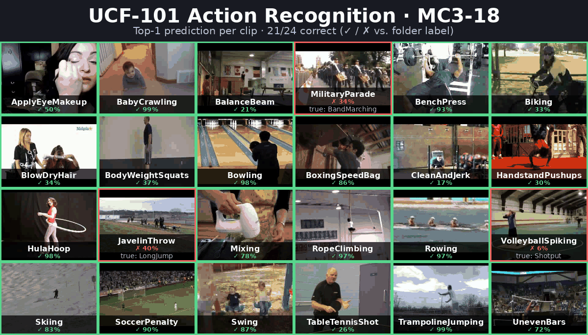

# Human Action Classification 🎬

[](https://www.python.org/)
[](https://pytorch.org/)
[](https://huggingface.co/dronefreak)
[](../LICENSE)

Action recognition for both **images** and **videos**: pose-aware single-frame classification with MediaPipe + timm, and temporal 3D-CNN video classification with torchvision's video models.



<sub>MC3-18 top-1 predictions on 24 UCF-101 split-1 test clips (green ✓ correct, red ✗ wrong). Regenerate with `python -m hac.video.inference.create_demo_gif`.</sub>

## Model Zoo

### Video (UCF-101, 101 classes, 16-frame clips @ 112×112)

| Model                                                         | Accuracy   | Params | Download                                                                                               |
| ------------------------------------------------------------- | ---------- | ------ | ------------------------------------------------------------------------------------------------------ |
| **[MC3-18](https://huggingface.co/dronefreak/mc3-18-ucf101)** | **87.05%** | 11.5M  | [](https://huggingface.co/dronefreak/mc3-18-ucf101) |
| **[R3D-18](https://huggingface.co/dronefreak/r3d-18-ucf101)** | 83.43%     | 33.2M  | [](https://huggingface.co/dronefreak/r3d-18-ucf101) |

### Video (HMDB51, 51 classes)

| Model                                                                      | Init         | Accuracy | Frames | Download                                                                                                            |
| -------------------------------------------------------------------------- | ------------ | -------- | ------ | ------------------------------------------------------------------------------------------------------------------- |
| **[MC3-18](https://huggingface.co/dronefreak/mc3-18-hmdb51-kinetics)**     | Kinetics-400 | 56.34%   | 8      | [](https://huggingface.co/dronefreak/mc3-18-hmdb51-kinetics)     |
| **[MC3-18](https://huggingface.co/dronefreak/mc3-18-hmdb51-ucf-transfer)** | UCF-101      | 55.46%   | 16     | [](https://huggingface.co/dronefreak/mc3-18-hmdb51-ucf-transfer) |

Both are reference baselines evaluated on split 1 only; see each model's card for the full training/evaluation writeup.

### Image (Stanford40, 40 classes, single 224×224 frame)

| Model                                                                                                       | Accuracy  | Download                                                                                                                                                   |
| ----------------------------------------------------------------------------------------------------------- | --------- | ---------------------------------------------------------------------------------------------------------------------------------------------------------- |
| **[ResNet50](https://huggingface.co/dronefreak/human-action-classification-stanford40/tree/main/resnet50)** | **88.5%** | [](https://huggingface.co/dronefreak/human-action-classification-stanford40/tree/main/resnet50)         |
| ResNet34                                                                                                    | 86.4%     | [](https://huggingface.co/dronefreak/human-action-classification-stanford40/tree/main/resnet34)         |
| ResNet18                                                                                                    | 82.3%     | [](https://huggingface.co/dronefreak/human-action-classification-stanford40/tree/main/resnet18)         |
| MobileNetV3-Large                                                                                           | 82.1%     | [](https://huggingface.co/dronefreak/human-action-classification-stanford40/tree/main/mobilnetv3_large) |

Also includes real-time pose classification (sitting/standing/lying) via MediaPipe, fused with the CNN prediction.

Full model list and architectures: [timm_model_families.md](timm_model_families.md).

---

## Quick Start

```bash
pip install -e .            # core library
pip install -e ".[demo]"    # + Gradio web demo
pip install -e ".[dev,demo,train]"  # everything
```

### Video

```python
from huggingface_hub import hf_hub_download
from hac.video.inference.predictor import VideoPredictor

model_path = hf_hub_download(repo_id="dronefreak/mc3-18-ucf101", filename="mc318-ufc101-split-1.pth")
predictor = VideoPredictor(model_path=model_path, device="cuda")  # or "cpu"

result = predictor.predict_video("clip.mp4", top_k=3)
print(result["top_class"], result["top_confidence"])
```

CLI equivalent: `hac-infer --video clip.mp4 --model <path>` (add `--num_frames 8` for the Kinetics-400-initialized HMDB51 model; UCF-101 and UCF-101-initialized HMDB51 models use the default of 16).

### Image

```python
from hac import ImagePredictor

# Downloads weights + config from the Hub; a local .pth/.safetensors path also works
predictor = ImagePredictor(
    model_path="hf://dronefreak/human-action-classification-stanford40/resnet50",
    device="cuda",  # or "cpu"
    use_pose_estimation=True,
)
result = predictor.predict_image("person.jpg")

print(f"Pose: {result['pose']['class']}")
print(f"Action: {result['action']['top_class']} ({result['action']['top_confidence']:.2%})")
```

CLI equivalents: `hac-infer --image photo.jpg --model hf://dronefreak/human-action-classification-stanford40/resnet50`, `hac-infer --webcam --model ...`, or `hac-demo` for the Gradio web UI (image pipeline only -- there is no video-model web demo yet).

More complete examples: [`scripts/simple_demo.py`](../scripts/simple_demo.py) (annotated image output) and [`examples/quickstart.ipynb`](../examples/quickstart.ipynb).

---

## Training Your Own Models

```bash
# Video (UCF-101) -- after downloading UCF-101 + the official train/test splits
python -m hac.video.data.split_ucf101 --source UCF-101/ --output UCF-101-organized/ --splits ucfTrainTestlist/ --split_num 1
python -m hac.video.training.train --data_dir UCF-101-organized/ --model mc3_18 --pretrained --batch_size 32 --epochs 200

# Image (Stanford40)
python -m hac.image.training.train --data_dir data/ --model_name resnet50 --num_classes 40 --epochs 50 --batch_size 32
```

Both accept `--help` for the full set of options (mixup/cutmix, label smoothing, backbone freezing, resume, etc.). UCF-101: <https://www.crcv.ucf.edu/data/UCF101.php>. Stanford40: <http://vision.stanford.edu/Datasets/40actions.html>.

---

## Tests

```bash
pip install -e ".[dev]"
pytest tests/   # CPU-only, synthetic data, ~15 s
```

## Contributing

Bug fixes, new architectures, mobile/ONNX deployment guides, and documentation are all welcome -- see [CONTRIBUTING.md](CONTRIBUTING.md).

## Citation & License

Apache-2.0 -- see [LICENSE](../LICENSE). Citation metadata: [CITATION.cff](../CITATION.cff) / [CITATION.bib](../CITATION.bib).

```bibtex
@software{saksena2026hac,
  author       = {Saumya Saksena},
  title        = {{Human Action Classification: Pose-based and Video-based Models}},
  year         = 2026,
  publisher    = {GitHub},
  howpublished = {\url{https://github.com/dronefreak/human-action-classification}},
  version      = {2.0.0},
  abstract     = {Modern human action classification system supporting both pose-based (MediaPipe) and video-based (3D CNN) approaches. Includes 100+ model architectures achieving real-time performance for pose classification and reference implementations for temporal action recognition on UCF-101 (87\% accuracy) and HMDB51 (56\% accuracy).}
}
```

If you use the video models, please also cite the MC3/R3D architectures ([Tran et al., 2018](https://arxiv.org/abs/1711.11248)) and the datasets: [UCF-101](https://arxiv.org/abs/1212.0402), [HMDB51](https://serre-lab.clps.brown.edu/resource/hmdb-a-large-human-motion-database/), [Stanford40](http://vision.stanford.edu/Datasets/40actions.html) (BibTeX for all of these is in [CITATION.bib](../CITATION.bib)). Built with [MediaPipe](https://github.com/google-ai-edge/mediapipe), [timm](https://github.com/huggingface/pytorch-image-models), and [PyTorch](https://pytorch.org/).
